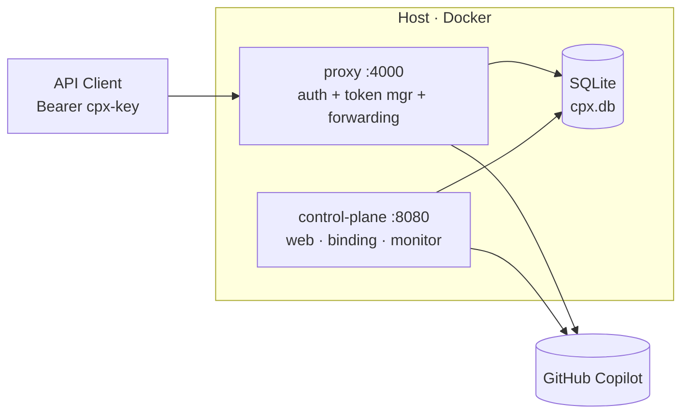
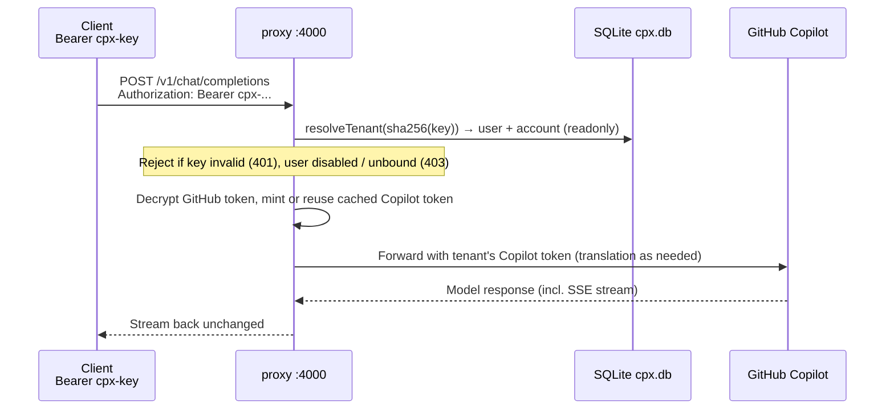

# Copilot Proxy · Multi-tenant

Centrally manage many GitHub Copilot accounts behind **one shared API endpoint**.
Each team member logs into a web platform, binds their own GitHub Copilot account
(via GitHub device flow), and gets a personal API key. Clients call the same
proxy URL with their key and reach their own Copilot models.

> 中文版：[README.zh-CN.md](README.zh-CN.md)

## Architecture

A **single-process, multi-tenant** design: one proxy process serves every user,
selecting the right GitHub → Copilot token per request. There are no per-account
containers.



- **control-plane** (`:8080`) — web platform: local login, admin user management,
  API-key management, GitHub device-flow binding. On bind it stores the account's
  **encrypted GitHub token** and validates it (no container is launched).
- **proxy** (`:4000`) — the single shared API endpoint **and** the multi-tenant
  Copilot proxy in one process (a fork of
  [`voidsteed/copilot-proxy-api`](https://github.com/voidsteed/copilot-proxy-api),
  MIT, running under Bun). It resolves `Bearer <cpx-key>` → user → that account's
  GitHub token, mints and caches the account's short-lived Copilot token, and
  serves the full OpenAI + Anthropic + Codex compatible surface (streaming-safe).
- **SQLite** (`./data/cpx.db`) — users, hashed API keys, encrypted GitHub tokens,
  usage logs. The control-plane writes it; the proxy reads it.

GitHub tokens are encrypted at rest with AES-256-GCM using `CPX_MASTER_KEY`, and
only decrypted inside the proxy process when a request needs them.

> **The fork, in one paragraph.** The upstream proxy keeps a single global
> `state.copilotToken`. The fork replaces that with an `AsyncLocalStorage`
> overlay: an auth middleware resolves the caller's `cpx-` key to a GitHub token,
> mints/caches that account's Copilot token, and runs the request inside a tenant
> context. Every existing `state.copilotToken` read becomes tenant-aware with no
> changes to the OpenAI/Anthropic/Codex translation layer. See
> [proxy/src/cpx/](proxy/src/cpx/) and [proxy/src/lib/state.ts](proxy/src/lib/state.ts).

### Request data flow

A single client call resolves `key → user → account → GitHub token` (all SQLite
lookups), the proxy mints/reuses that account's Copilot token, forwards to
GitHub Copilot, and streams the response back unchanged.



## Quick start

```bash
cp .env.example .env
# Edit .env: set CPX_MASTER_KEY (64-char hex), CPX_ADMIN_PASS, CPX_SESSION_SECRET.
node -e "console.log(require('crypto').randomBytes(32).toString('hex'))"  # master key

docker compose up --build -d
```

Then:

1. Open `http://localhost:8080`, log in as the bootstrap admin (`CPX_ADMIN_USER` /
   `CPX_ADMIN_PASS`).
2. Admin → create users for your team.
3. As a user: **Connect GitHub Copilot** → open the shown URL, enter the code,
   approve. The account's token is stored and validated (no container to start).
4. **Create API key** on the dashboard (copy it — shown once).
5. Use the unified endpoint:

```bash
curl http://localhost:4000/v1/models -H "Authorization: Bearer YOUR_CPX_KEY"
curl http://localhost:4000/v1/chat/completions \
  -H "Authorization: Bearer YOUR_CPX_KEY" \
  -H "Content-Type: application/json" \
  -d '{"model":"gpt-4o","messages":[{"role":"user","content":"hi"}]}'
```

6. Watch consumption under **Dashboard → Usage & stats**, or fire test requests
   straight from the browser on **Dashboard → Client examples** (pick a model,
   Send). Admins get a global view under **Admin → Usage & stats**.

## Local dev

```bash
npm install                       # control-plane + shared (Node)
# terminal 1 — control-plane (Node/tsx)
npm run dev:cp
# terminal 2 — proxy (Bun; install Bun from https://bun.sh)
( cd proxy && bun install )       # first time only
npm run dev:proxy
```

> Both services must point at the **same** SQLite file. `npm -w <pkg> run` sets
> the working directory to the package folder, so a relative `CPX_DB_PATH` would
> resolve per-package and silently split the DB. The `dev:*` scripts and the
> compose file both use an absolute path to avoid this.

> The `dev:*` scripts also auto-load `.env` (`set -a; . ./.env; set +a`) — neither
> `tsx` nor `bun` reads the repo-root `.env` on its own, and a missing
> `CPX_MASTER_KEY` would leave the control-plane unable to decrypt stored tokens
> (every account then shows `error`). In local dev the proxy binds
> `CPX_GATEWAY_PORT` (4000) directly; the internal `4141` only matters inside
> Docker, where compose maps `4000→4141`.

The proxy runs under **Bun** (it uses the built-in `bun:sqlite` to read the shared
DB and `node:crypto` to decrypt tokens). No container is launched on bind — the
proxy uses the stored GitHub token directly at request time.

## Proxy error codes

Auth/routing errors use the shape `{"error":{"message","type"}}`. A background
monitor in the control-plane re-validates each account's GitHub token every 60s
(default) via the Copilot token exchange and reconciles `account.status`.

| HTTP | `error.type` | When |
| --- | --- | --- |
| 401 | `authentication_error` | No key, unknown key, or revoked key |
| 403 | `account_disabled` | The user has been disabled by an admin |
| 403 | `account_unbound` | Valid key but the user has not bound a Copilot account |
| 403 | `account_not_ready` | Bound, but the GitHub token can't mint a Copilot token (logged out / revoked) |
| 200 + upstream codes | — | Healthy; forked copilot-proxy-api responses pass through unchanged |

Notes:
- Disabled users and revoked keys are rejected in **real time** by the proxy's
  tenant resolution — no waiting on the health monitor.
- Set `CPX_VERBOSE=1` on the proxy for verbose upstream logging (server-side only).

## Usage metering & dashboards

Every model call is metered. A response-boundary middleware in the proxy parses
the upstream `usage` block — for non-streaming JSON and for streaming SSE (it
**tees** the stream, so the bytes sent to the client are untouched) — and writes
**one row per call** to `usage_logs`: user / account / key / endpoint / model /
HTTP status / stream flag, plus `prompt_tokens`, `completion_tokens`,
`cached_tokens`, `reasoning_tokens`, `total_tokens`, `duration_ms` and `ttfb_ms`.
Prompt and response **content is never stored** — only counts.

The control-plane renders this back as dashboards:

| Page | Who | Shows |
| --- | --- | --- |
| `/dashboard/usage` | each user | summary cards, daily request/token charts, per-model breakdown, recent requests |
| `/admin/usage` | admin | global totals, top users, per-model split, recent requests, CSV export |
| `/admin/users/:id/usage` | admin | a single user's usage |

All views take a `?days=7\|30\|90` window. The token/cost numbers originate from
the upstream model response; where they come from per surface:

| API surface | Token fields in the response |
| --- | --- |
| OpenAI Chat Completions | `usage.prompt_tokens`, `usage.completion_tokens`, `usage.total_tokens` |
| OpenAI Responses | `usage.input_tokens`, `usage.output_tokens`; plus `copilot_usage.total_nano_aiu` (billing units) |
| Anthropic Messages | `usage.input_tokens`, `usage.output_tokens`, `usage.cache_read_input_tokens` |

Notes:
- Prompt caching is real on this path: with Anthropic `cache_control`, warm calls
  show `cache_read_input_tokens` > 0 and billed input collapses to the new tokens
  — surfaced as the **cache-hit %** on the dashboards.
- Inspect the raw table directly any time:

```bash
docker compose exec -T control-plane node -e "
const db=require('better-sqlite3')('/app/data/cpx.db');
console.table(db.prepare('SELECT id,user_id,model,status_code,prompt_tokens,completion_tokens,total_tokens,duration_ms,created_at FROM usage_logs ORDER BY id DESC LIMIT 20').all());
"
```

## Notes / limits (demo)

- Sessions are in-memory; restarting control-plane logs users out.
- **Single-process, multi-tenant:** all tenants are served by one Bun process, so
  every bound account's GitHub token is decrypted in that process's memory when
  used (tokens remain AES-encrypted at rest). This trades per-account isolation
  for a much smaller footprint — one process instead of one container per user.
- Heavy automated traffic across many accounts can trip GitHub abuse detection.
- The proxy is a fork of
  [`voidsteed/copilot-proxy-api`](https://github.com/voidsteed/copilot-proxy-api)
  (MIT); it relies on a reverse-engineered Copilot API — review GitHub Copilot terms.
