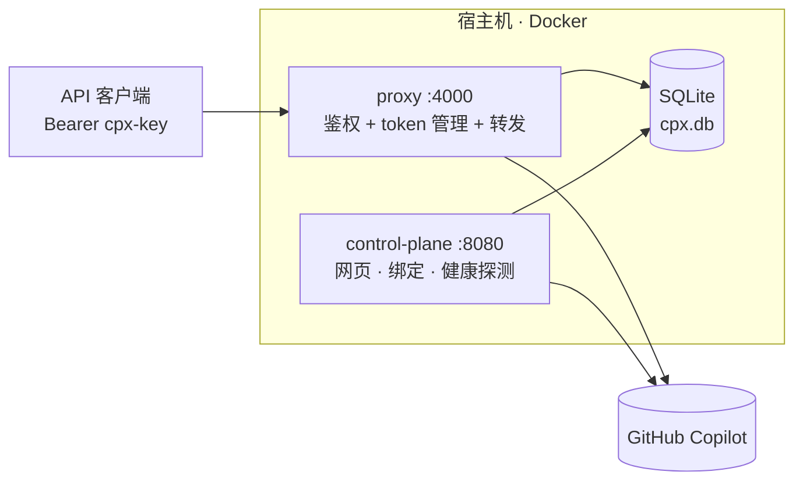
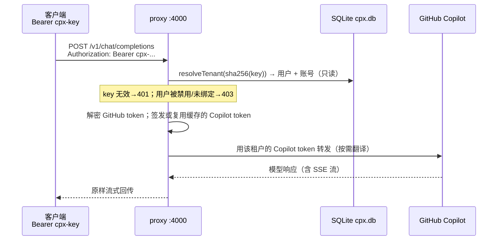

# Copilot Proxy · Multi-tenant

在**同一个共享 API 地址**背后，集中管理多个 GitHub Copilot 账号。
每个团队成员登录平台网页，绑定自己的 GitHub Copilot 账号（通过 GitHub 设备码授权），
并获得一个专属 API key。所有人调用同一个代理地址，用各自的 key 即可访问自己账号下的 Copilot 模型。

> English version: [README.md](README.md)

## 架构

**单进程、多租户**设计：一个代理进程服务所有用户，按请求选择对应的 GitHub → Copilot
token。**不再为每个用户开一个容器。**



- **control-plane（控制面，`:8080`）** — 平台网页：本地账号登录、管理员用户管理、
  API key 管理、GitHub 设备码绑定。绑定时只**存储该账号加密后的 GitHub token** 并校验
  其有效性（不再启动任何容器）。
- **proxy（代理，`:4000`）** — 唯一对外的共享 API 地址，**同时**是多租户 Copilot 代理，
  合并在同一个进程里（fork 自
  [`voidsteed/copilot-proxy-api`](https://github.com/voidsteed/copilot-proxy-api)，
  MIT，运行在 Bun 上）。它把 `Bearer <cpx-key>` 解析为 用户 → 该账号的 GitHub token，
  据此签发并缓存该账号的短期 Copilot token，再提供完整的 OpenAI + Anthropic + Codex
  兼容接口（支持流式）。
- **SQLite（`./data/cpx.db`）** — 用户、哈希后的 API key、加密的 GitHub token、用量日志。
  控制面写入，代理只读。

GitHub token 使用 `CPX_MASTER_KEY` 通过 AES-256-GCM 加密存储，只有在请求需要时才在代理
进程内存中解密。

> **一句话说清这个 fork。** 上游代理用一个全局的 `state.copilotToken`。fork 把它换成基于
> `AsyncLocalStorage` 的覆盖层：鉴权中间件把调用方的 `cpx-` key 解析成 GitHub token，
> 签发/缓存该账号的 Copilot token，并在一个"租户上下文"里执行请求。于是原代码里所有对
> `state.copilotToken` 的读取都自动变成按租户取值，**翻译层一行都不用改**。见
> [proxy/src/cpx/](proxy/src/cpx/) 和 [proxy/src/lib/state.ts](proxy/src/lib/state.ts)。

### 请求数据流

一次客户端调用按 `key → 用户 → 账号 → GitHub token` 逐跳解析（全部是 SQLite 查询），
代理据此签发/复用该账号的 Copilot token，转发给 GitHub Copilot，并原样流式回传响应。



## 快速开始

```bash
cp .env.example .env
# 编辑 .env：设置 CPX_MASTER_KEY（64位十六进制）、CPX_ADMIN_PASS、CPX_SESSION_SECRET。
node -e "console.log(require('crypto').randomBytes(32).toString('hex'))"  # 生成主密钥

docker compose up --build -d
```

然后：

1. 打开 `http://localhost:8080`，用初始管理员账号登录（`CPX_ADMIN_USER` /
   `CPX_ADMIN_PASS`）。
2. 管理员 → 为团队成员创建用户。
3. 作为用户：点击 **Connect GitHub Copilot** → 打开页面给出的链接，输入验证码，
   完成授权。账号 token 会被存储并校验（不再启动任何容器）。
4. 在面板上 **Create API key**（只显示一次，请立即复制）。
5. 使用统一的 API 地址：

```bash
curl http://localhost:4000/v1/models -H "Authorization: Bearer YOUR_CPX_KEY"
curl http://localhost:4000/v1/chat/completions \
  -H "Authorization: Bearer YOUR_CPX_KEY" \
  -H "Content-Type: application/json" \
  -d '{"model":"gpt-4o","messages":[{"role":"user","content":"hi"}]}'
```

## 本地开发

```bash
npm install                       # control-plane + shared（Node）
# 终端 1 —— 控制面（Node/tsx）
npm run dev:cp
# 终端 2 —— 代理（Bun；从 https://bun.sh 安装）
( cd proxy && bun install )       # 仅首次
npm run dev:proxy
```

> 两个服务必须指向**同一个** SQLite 文件。`npm -w <pkg> run` 会把工作目录切到子包目录，
> 因此相对的 `CPX_DB_PATH` 会被解析到各自的包目录，导致数据库被悄悄分裂。`dev:*`
> 脚本和 compose 文件都使用绝对路径以规避此问题。

代理运行在 **Bun** 上（用内置的 `bun:sqlite` 读共享 DB、用 `node:crypto` 解密 token）。
绑定时不再启动任何容器 —— 代理在请求时直接使用存好的 GitHub token。

## 代理错误码

鉴权 / 路由类错误统一用 `{"error":{"message","type"}}` 结构。控制面有一个后台探测，
默认每 60 秒通过 Copilot token 交换重新校验每个账号的 GitHub token，并校正 `account.status`。

| HTTP | `error.type` | 何时出现 |
| --- | --- | --- |
| 401 | `authentication_error` | 没有 key、未知 key、或已吊销的 key |
| 403 | `account_disabled` | 该用户被管理员停用 |
| 403 | `account_unbound` | key 有效，但该用户尚未绑定 Copilot 账号 |
| 403 | `account_not_ready` | 已绑定，但 GitHub token 无法换取 Copilot token（登出 / 被吊销） |
| 200 + 上游状态码 | — | 健康；fork 版 copilot-proxy-api 的响应原样透传 |

说明：
- 被停用的用户、被吊销的 key 会被代理在**实时**拒绝（无需等健康探测）。
- 在代理上设置 `CPX_VERBOSE=1`，可在服务端日志中开启更详细的上游日志。

## Token 计量

网关的 `usage_logs` 表**每次调用记录一行**（谁 / 哪个账号 / 路径 / 模型 / HTTP 状态码 /
时间戳）—— **不**存储 token 数量。可直接查询：

```bash
docker compose exec -T control-plane node -e "
const db=require('better-sqlite3')('/app/data/cpx.db');
console.table(db.prepare('SELECT id,user_id,account_id,path,model,status_code,created_at FROM usage_logs ORDER BY id DESC LIMIT 20').all());
"
```

token 消耗本身由**上游模型在响应体里返回**，而不是由代理统计。具体读哪个字段取决于你调用的接口：

| 接口 | 路径 | 响应 JSON 中的 token 字段 |
| --- | --- | --- |
| OpenAI Chat Completions | `/v1/chat/completions` | `usage.prompt_tokens`、`usage.completion_tokens`、`usage.total_tokens` |
| OpenAI Responses | `/v1/responses` | `usage.input_tokens`、`usage.output_tokens`；另有 `copilot_usage.token_details[]`（按类型给出 `token_count`：`input` / `output` / `cache_read`）和 `copilot_usage.total_nano_aiu`（计费单位） |
| Anthropic Messages | `/v1/messages` | `usage.input_tokens`、`usage.output_tokens`、`usage.cache_read_input_tokens`（缓存命中） |

说明：
- **流式**请求下，OpenAI 只有在你传了 `"stream_options": {"include_usage": true}` 时，
  才会在最后一个 chunk 里带上 `usage`；Anthropic 默认会在 `message_delta` / 末尾事件里返回 usage。
- 网关目前**不**把这些字段解析进数据库（它原样反向代理字节流）。若要按 token 计量，
  要么让客户端自己读取每次响应里的 `usage`，要么扩展代理嗅探末尾的 `usage`，
  并在 `usage_logs` 中新增 `prompt/completion/total` 列。
- 该链路上 prompt caching 是真实生效的：配合 Anthropic 的 `cache_control`，热调用会显示
  `cache_read_input_tokens` > 0，计费 input 降到只剩新增的 token。

## 说明 / 限制（demo 阶段）

- 会话存储在内存中；重启 control-plane 会让用户登出。
- **单进程、多租户**：所有租户由同一个 Bun 进程服务，因此每个已绑定账号的 GitHub token
  会在用到时于该进程内存中解密（静态存储仍是 AES 加密）。这用「牺牲逐账号隔离」换来了
  「一个进程而非每人一个容器」的极小开销。
- 跨多个账号的大量自动化流量可能触发 GitHub 滥用检测。
- 代理是 [`voidsteed/copilot-proxy-api`](https://github.com/voidsteed/copilot-proxy-api)
  的 fork（MIT）；它依赖逆向的 Copilot API，请自行确认是否符合 GitHub Copilot 条款。
